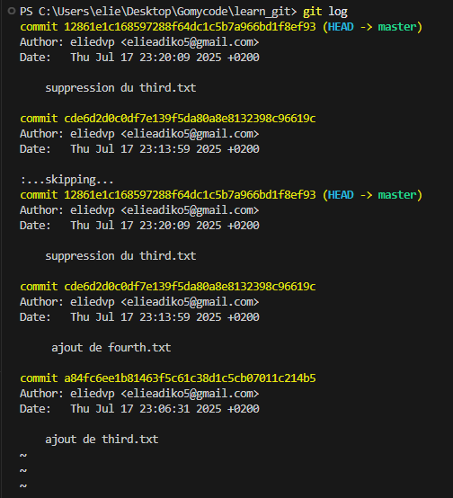
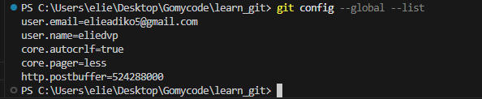

# learn_git — apprentissage des commandes Git

Exercice réalisé pendant la formation GoMyCode : manipuler un dépôt Git en ligne de commande et documenter chaque étape par une capture d'écran.

## Déroulé de l'exercice

L'historique du dépôt retrace les étapes :

1. ajout de `third.txt` ;
2. ajout de `fourth.txt` ;
3. suppression de `third.txt` ;
4. ajout des captures d'écran dans `captures_learn_git/`.

## Notions travaillées

- Configuration de Git (`git config --global --list`)
- Indexation et validation (`git add`, `git commit`)
- Suppression d'un fichier suivi
- Lecture de l'historique (`git log`)

## Aperçu

Historique des commits :

Configuration globale de Git :

Les autres étapes sont illustrées dans le dossier [`captures_learn_git/`](captures_learn_git/).

## Stack

Git, GitHub, terminal PowerShell sous VS Code.
